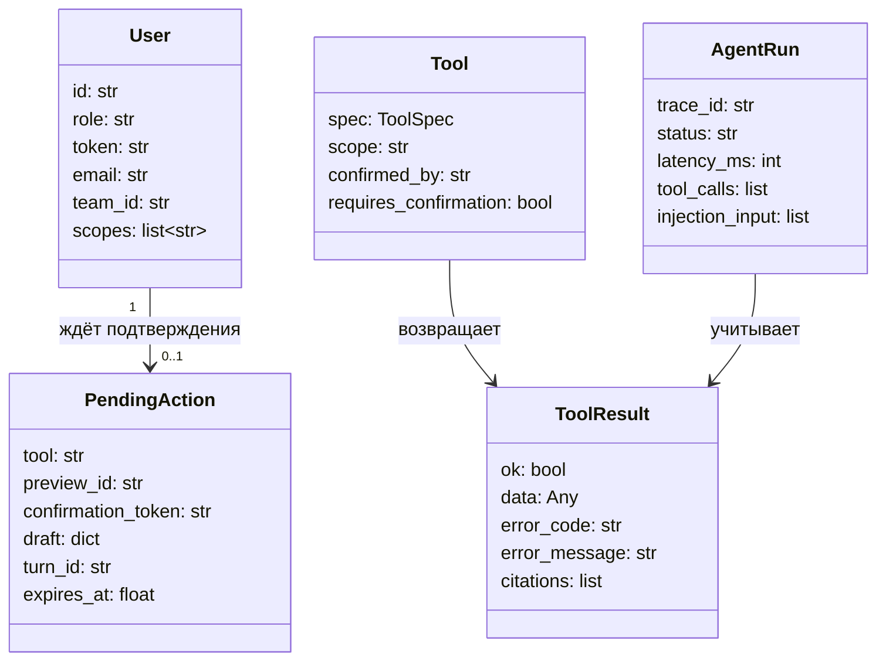

# Модель данных AI-сервиса

AI-сервис не хранит данные в БД. Таблицы core (`users`, `onboarding_*`, `kb_documents`,
`doc_chunks`, `requests`, `audit_log`, …) описаны в `core/migrations/` и
[`docs/api-contract.md`](../../docs/api-contract.md). Ниже — сущности внутри `ai`.

| Сущность | Где | Жизнь |
|---|---|---|
| `User` | `app/auth.py` | Один запрос; из claims JWT core |
| `Tool`, `ToolSpec` | `app/agent/tools.py` | Константы; схемы — в [`contracts/mcp/`](contracts/mcp) |
| `ToolResult` | `app/agent/tools.py` | Один вызов; модели уходит `{"ok", "result"}` или `{"ok", "error"}` |
| `PendingAction` | `app/agent/pending.py` | В памяти, один на пользователя, TTL 10 минут |
| `AgentRun` | `app/agent/run_log.py` | Один запрос; пишется JSON-логом `agent_run` |

## Лог `agent_run`

Соответствует таблице `agent_runs` из ARCHITECTURE; пока пишется в stdout JSON-строкой.

| Поле | Тип | Пример |
|---|---|---|
| `trace_id` | str | из `X-Trace-Id` / `X-Request-ID` |
| `user_id`, `role` | str | `22222222-…`, `intern` |
| `prompt_version`, `model` | str | `v1`, `gpt-4o-mini` |
| `status` | str | `ok`, `limit`, `llm_error`, `error`, `cancelled` |
| `error` | str \| null | текст ошибки LLM или тип исключения |
| `latency_ms` | int | 1035 |
| `tool_iterations`, `llm_retries` | int | 2, 0 |
| `input_tokens`, `output_tokens` | int | 250, 30 |
| `message_length` | int | длина сообщения; сам текст не пишется |
| `tool_calls` | list | `[{"name","status","error_code","latency_ms"}]` |
| `injection_input`, `injection_tools` | list | флаги эвристики injection |
