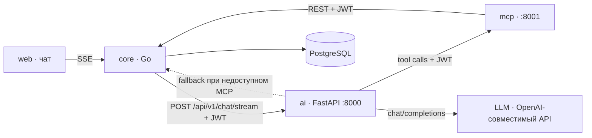
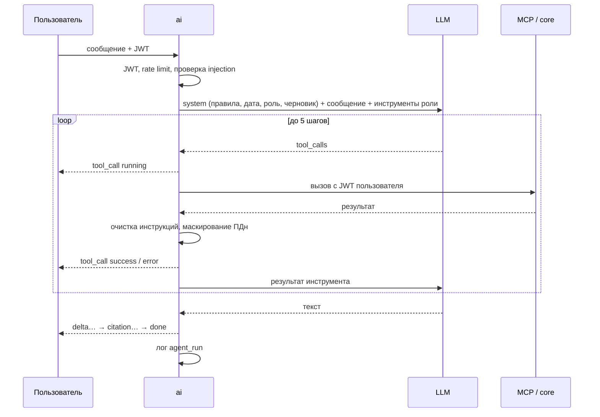
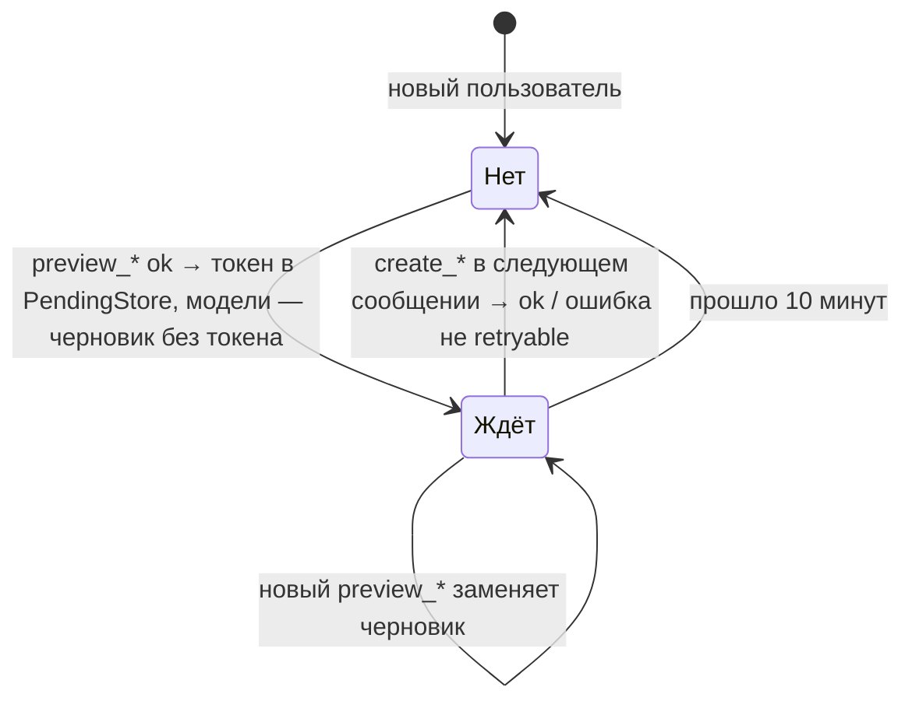

# План реализации: AI-сервис

Как устроена реализация требований из [spec.md](spec.md). Код — в [`ai/`](../../ai).

## 1. Место в системе

- **ai** не ходит в БД: всё через REST core с JWT пользователя.
- **mcp** — тот же образ, другой процесс (`python -m app.mcp`): тонкие адаптеры к core.
- **LLM** — `LLM_MODE=mock` (по умолчанию) или `real`.

## 2. Компоненты

| Модуль | Ответственность | Требования |
|---|---|---|
| `app/api/chat.py` | `POST /api/v1/chat/stream`: JWT, rate limit, trace id, SSE | FR-01, FR-02, FR-15 |
| `app/auth.py` | Проверка JWT core, `User` со скоупами | FR-02 |
| `app/agent/loop.py` | Агентный цикл, подтверждения, guardrails, стриминг | FR-03, FR-07, FR-10, FR-13 |
| `app/agent/tools.py` | Описания инструментов, скоупы, `CoreClient`, маппинг ошибок, поиск, handoff | FR-04, FR-05, FR-06, FR-18 |
| `app/agent/pending.py` | Черновики действий со скрытым токеном, TTL | FR-08 |
| `app/agent/history.py` | История диалога: последние пары «вопрос — ответ» на пользователя | FR-17 |
| `app/agent/mcp_tools.py` | Клиент MCP с fallback на прямые вызовы | FR-09 |
| `app/mcp/server.py` | MCP-сервер: проверка JWT, вызов того же `ToolRegistry` | FR-09 |
| `app/agent/prompts.py`, `app/prompts/v1/system.md` | Системный промпт + контекст (дата, роль, черновик) | — |
| `app/providers/` | `mock.py` (сценарии), `openai_compat.py` (real) | FR-10, FR-16 |
| `app/guardrails/` | Injection, очистка данных, маскирование, rate limit | FR-12…FR-15 |
| `app/agent/run_log.py`, `app/observability.py` | JSON-логи `agent_run` | FR-11 |
| `evals/` | Golden и injection наборы, fake core, отчёты | метрики §8 спеки |

## 3. Поток одного сообщения

## 4. Подтверждение действий

- Ход (`turn_id`) — один вызов `Agent.run`. `create_*` разрешён, только если черновик создан
  в **другом** ходе, иначе модель получает `CONFIRMATION_REQUIRED`.
- Модель вызывает `create_*` **без аргументов**: `preview_id`, `confirmation_token` и
  `idempotency_key = preview_id` подставляет агент. Модель не может подделать токен.
- Строки «Ожидает подтверждения: {черновик}» и «Инструмент для подтверждения: …» добавляются
  в системный промпт следующего хода — так модель понимает, на что пользователь говорит «да».

## 5. Поиск по базе знаний

Core ищет подстроку целиком (`ILIKE '%q%'`) с ACL по роли. Поверх этого `search_knowledge`:

1. Ищет всю фразу; если нашлось — готово.
2. Иначе — до 4 ключевых слов: без стоп-слов, короче 3 символов не берём, у русских слов
   отрезаем окончание («релизы» → «релиз», «отпуска» → «отпуск»).
3. Документ получает сумму оценок по всем словам; в ответ — топ-3, они же — цитаты.
   Документы слабее половины лучшего отсекаются, чтобы не было случайных цитат.
4. Core в поиске отдаёт только строку документа, где нашлось слово. Для лучшего документа
   агент запрашивает `GET /api/v1/kb/documents/{id}` и отдаёт модели полный текст (до 2000
   символов). Если документ недоступен (`403`/`404`/таймаут) — остаётся найденная строка.

## 6. Guardrails

| Слой | Что делаем | Где |
|---|---|---|
| Вход | Длина ≤ 4000, rate limit, флаги injection → предупреждение в промпт | `api/chat.py`, `guardrails/injection.py` |
| Инструменты | Allowlist по скоупам, валидация аргументов, таймауты 5 с (preview 10 с), подтверждение мутаций | `agent/tools.py`, `agent/loop.py` |
| Данные | Предложения-инструкции → «[фрагмент скрыт…]», после этого действия блокируются | `guardrails/output.py` |
| Выход | Маскирование email, телефонов, секретов | `guardrails/pii.py` |

## 7. Конфигурация

| Переменная | По умолчанию | Назначение |
|---|---|---|
| `LLM_MODE` | `mock` | `mock` или `real` |
| `LLM_BASE_URL`, `LLM_MODEL`, `LLM_API_KEY` | OpenAI, `gpt-4o-mini`, — | OpenAI-совместимый провайдер |
| `LLM_RETRIES`, `LLM_RETRY_DELAY` | `1`, `0.5` | Повтор временных ошибок LLM |
| `TOOLS_MODE`, `MCP_URL` | `mcp`, `http://localhost:8001/mcp` | Через MCP или напрямую в core |
| `CORE_URL`, `JWT_SECRET` | `http://localhost:8081`, dev-секрет | Core и проверка JWT |
| `MAX_TOOL_ITERATIONS`, `TOOL_TIMEOUT` | `5`, `5.0` | Лимиты цикла |
| `RATE_LIMIT_PER_MINUTE` | `20` | Сообщений в минуту на пользователя |
| `HISTORY_TURNS`, `HISTORY_TTL` | `5`, `1800` | Сколько пар «вопрос — ответ» помнить и сколько секунд |
| `PROMPT_VERSION` | `v1` | Папка промпта, пишется в `agent_run` |
| `LOG_LEVEL`, `LOG_JSON` | `info`, `true` | Логи |

## 8. Решения

| Решение | Почему | Альтернатива |
|---|---|---|
| Свой httpx-клиент к `/chat/completions` | Одна зависимость, любой OpenAI-совместимый провайдер, проще тестировать | LiteLLM — тяжелее, лишние зависимости |
| Сценарный mock по умолчанию | Демо и CI без ключа и сети | Записанные ответы LLM — хрупко |
| Токен подтверждения прячется от модели | Модель не может подтвердить сама или подделать токен | Отдавать токен модели — риск injection |
| Черновики в памяти | Достаточно для одного экземпляра на демо | Redis — при масштабировании |
| Поиск через core + стемминг | ACL остаётся в одном месте (core) | Эмбеддинги в AI — дублирование ACL |
| MCP SDK 2.x, stateless HTTP | Каждый вызов несёт JWT пользователя в заголовке | stdio — нет проброса JWT |
| Fallback MCP → core | Демо не падает, если MCP-процесс не запущен | Ошибка пользователю |

## 9. Известные ограничения

- История диалога — только текст вопросов и ответов, без результатов инструментов: данные
  модель каждый раз берёт заново. Нет summary для длинных диалогов.
- Черновики и история теряются при рестарте `ai` и не делятся между экземплярами.
- Эвристика injection ловит только явные атаки; основная защита — подтверждение и права core.
- На real LLM наборы evals ещё не прогонялись (нужен ключ).
